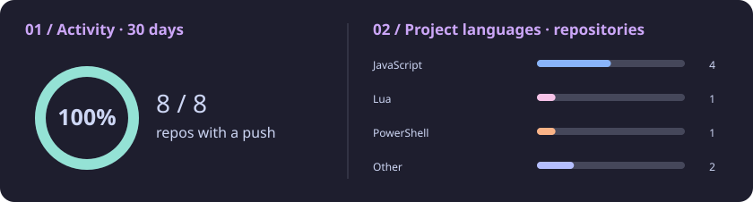

# MoLik Labs

MoLik Labs is a non-commercial software lab led by [NggKhaiz - Raven](https://github.com/NggKhaiz). We build and experiment together, from Windows tooling to small web apps. Our projects include a way to build a leaner Windows image, a method for solving a 3×3 cube, and a study app small enough to live in one HTML file.

[Project atlas](#project-atlas) · [Lab pulse](#lab-pulse) · [People](#people--workbench) · [Visit the lab](https://nggkhaiz.js.org/labs/) · [Browse all repositories](https://github.com/orgs/MoLik-Labs/repositories)

Giới thiệu bằng tiếng Việt

MoLik Labs là nơi **NggKhaiz - Raven** và anh em trong lab cùng làm phần mềm phi thương mại. Tụi mình xây công cụ cho Windows, thử nghiệm phương pháp giải Rubik 3×3 và viết cả ứng dụng học tập trong một tệp HTML. Mỗi dự án có kho mã riêng; bạn có thể bắt đầu từ bảng bên dưới hoặc ghé [trang của lab](https://nggkhaiz.js.org/labs/).

## Project atlas

| Track | Where to start | What to look for |
| :--- | :--- | :--- |
| **Systems** | [ZMRIG](https://github.com/MoLik-Labs/ZMRIG) | RandomX miner written in **Zig**, alongside pool and proxy components. Read the miner from [`main.zig`](https://github.com/MoLik-Labs/ZMRIG/blob/BETA/zmrig/src/main.zig). |
| **Windows** | [TINY11-AUTOMATION](https://github.com/MoLik-Labs/TINY11-AUTOMATION) · [MOLIK_WINLIK](https://github.com/MoLik-Labs/MOLIK_WINLIK) | Two entry points: build a streamlined Windows image with Actions, or tune an existing installation with PowerShell. WINLIK builds on [Sophia Script](https://github.com/farag2/Sophia-Script-for-Windows). |
| **Algorithms** | [Q-FOX](https://github.com/MoLik-Labs/Q-FOX-Algorithm) | Follow a 3×3 cube method from the [engine](https://github.com/MoLik-Labs/Q-FOX-Algorithm/tree/main/engine) to the [results](https://github.com/MoLik-Labs/Q-FOX-Algorithm/tree/main/results). |
| **Web tools** | [Study Focus Fox](https://github.com/MoLik-Labs/STUDY-SITE) | A study app in a single HTML file. The interface and the logic can be read together without navigating a framework. |

## Lab pulse

A daily snapshot of public projects, excluding forks, archives and this profile. The ring measures repository activity, not individual productivity.

<!-- index:start -->
> **Field notes · 2026.11** — [ZMRIG](https://github.com/MoLik-Labs/ZMRIG/blob/BETA/zmrig/src/main.zig) · Start at the Zig entry point for the RandomX miner.

**5 of 5 repositories pushed in the last 30 UTC days.** Each repository counts once. We use GitHub’s primary language except for ZMRIG, classified by its Zig miner core.

| Tracked projects | Stars received | Forks received |
| :--- | :--- | :--- |
| 5 | 15 | 1 |

### Recently updated

Latest five by push date (UTC).

| Repository | Project language | Last push |
| :--- | :--- | :--- |
| [STUDY-SITE](https://github.com/MoLik-Labs/STUDY-SITE) | JavaScript | 2026-11-19 |
| [Q-FOX-Algorithm](https://github.com/MoLik-Labs/Q-FOX-Algorithm) | JavaScript | 2026-11-19 |
| [MOLIK_WINLIK](https://github.com/MoLik-Labs/MOLIK_WINLIK) | PowerShell | 2026-11-19 |
| [AAOBF](https://github.com/MoLik-Labs/AAOBF) | Lua | 2026-11-18 |
| [ZMRIG](https://github.com/MoLik-Labs/ZMRIG) | Zig | 2026-11-15 |
<!-- index:end -->

## People & workbench

**Nguyễn Gia Khải · NggKhaiz / Raven** leads the lab. The organization is our shared workspace; [Raven’s profile](https://github.com/NggKhaiz) is his personal engineering notebook. His setup pairs C, C++ and Zig for systems work with Python for tooling and hand-written HTML, CSS and JavaScript for interfaces.

<picture>
  <source media="(prefers-color-scheme: light)" srcset="https://raw.githubusercontent.com/NggKhaiz/NggKhaiz/main/assets/highlights-light.svg">
  
</picture>

Under the hood · how the two profiles are built

| | Data | Presentation |
| :--- | :--- | :--- |
| **MoLik Labs** | The [daily workflow](https://github.com/MoLik-Labs/.github/actions/workflows/profile.yml) reads the organization’s public repository metadata. | [Python scripts](https://github.com/MoLik-Labs/.github/tree/main/scripts) draw the activity ring and language bars as SVG, then refresh only the marked section of this page. |
| **NggKhaiz** | [`fetch_stats.py`](https://github.com/NggKhaiz/NggKhaiz/blob/main/tools/fetch_stats.py) collects the [profile snapshot](https://github.com/NggKhaiz/NggKhaiz/blob/main/data/profile.json). | The [build tools](https://github.com/NggKhaiz/NggKhaiz/tree/main/tools) turn that snapshot into profile artwork, a README and web pages. The highlights above are served directly from that project. |

**Find the right person.** For a project question, start in that repository so the people working on it have the context. For a direct note to Raven: [email](mailto:nggkhaiz@proton.me) · [personal site](https://nggkhaiz.js.org). Explore the lab’s [public people directory](https://github.com/orgs/MoLik-Labs/people); it only lists members who choose public visibility.
