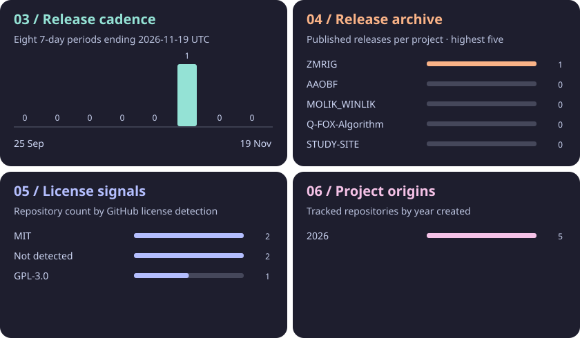

# MoLik Labs

MoLik Labs is a non-commercial software lab led by [NggKhaiz - Raven](https://github.com/NggKhaiz). We build and experiment together, from Windows tooling to small web apps. Pick a project below, or use the field manual to check compatibility, verify a download or find a test suite.

[Projects](#project-atlas) · [Field manual](#field-manual) · [Lab pulse](#lab-pulse) · [People](#people--workbench) · [Visit the lab](https://nggkhaiz.js.org/labs/) · [Browse all repositories](https://github.com/orgs/MoLik-Labs/repositories)

Giới thiệu bằng tiếng Việt

MoLik Labs là nơi **NggKhaiz - Raven** và anh em trong lab cùng làm phần mềm phi thương mại. Tụi mình xây công cụ cho Windows, thử nghiệm phương pháp giải Rubik 3×3 và viết ứng dụng lên lịch học theo tuần. Mỗi dự án có kho mã riêng; bạn có thể bắt đầu từ bảng bên dưới hoặc ghé [trang của lab](https://nggkhaiz.js.org/labs/).

## Project atlas

| Track | Where to start | What to look for |
| :--- | :--- | :--- |
| **Systems** | [ZMRIG](https://github.com/MoLik-Labs/ZMRIG) | RandomX miner written in **Zig**, alongside pool and proxy components. Read the miner from [`main.zig`](https://github.com/MoLik-Labs/ZMRIG/blob/BETA/zmrig/src/main.zig). |
| **Windows** | [TINY11-AUTOMATION](https://github.com/MoLik-Labs/TINY11-AUTOMATION) · [MOLIK_WINLIK](https://github.com/MoLik-Labs/MOLIK_WINLIK) | Two entry points: build a streamlined Windows image with Actions, or tune an existing installation with PowerShell. WINLIK builds on [Sophia Script](https://github.com/farag2/Sophia-Script-for-Windows). |
| **Algorithms** | [Q-FOX](https://github.com/MoLik-Labs/Q-FOX-Algorithm) | Follow a 3×3 cube method from the [engine](https://github.com/MoLik-Labs/Q-FOX-Algorithm/tree/main/engine) to the [results](https://github.com/MoLik-Labs/Q-FOX-Algorithm/tree/main/results). |
| **Web tools** | [Study Focus Fox](https://github.com/MoLik-Labs/STUDY-SITE) | A weekly planner with course notes and progress tracking. Guest mode keeps study data on the device; an account enables sync. |

## Lab pulse

A daily snapshot of public projects, excluding forks, archives and this profile. The ring measures repository activity, not individual productivity.

<!-- index:start -->
> **Field notes · 2026.11** — [ZMRIG](https://github.com/MoLik-Labs/ZMRIG/blob/BETA/zmrig/src/main.zig) · Start at the Zig entry point for the RandomX miner.

**8 of 8 repositories pushed in the last 30 UTC days.** Each repository counts once. We use GitHub’s primary language except for ZMRIG, classified by its Zig miner core.

Chart data &amp; reading notes

- **Release cadence**, oldest week first: 0 · 0 · 0 · 0 · 1 · 0 · 0 · 0
- **Release archive:** ZMRIG: 1, AAOBF: 0, Kova-INC: 0, MOLIK_WINLIK: 0, OpenBullet2: 0
- **License signals:** MIT: 3, Not detected: 3, AGPL-3.0: 1, GPL-3.0: 1
- **Project origins:** 2026: 8

Release charts include published prereleases, not draft releases or bare tags. Creation year is the repository date, not the first upstream commit.

### Recently updated

Latest five by push date (UTC).

| Repository | Project language | Last push |
| :--- | :--- | :--- |
| [Kova-INC](https://github.com/MoLik-Labs/Kova-INC) | JavaScript | 2026-11-24 |
| [Q-FOX-Algorithm](https://github.com/MoLik-Labs/Q-FOX-Algorithm) | JavaScript | 2026-11-21 |
| [OpenBullet2](https://github.com/MoLik-Labs/OpenBullet2) | — | 2026-11-20 |
| [SHOPCLONE7_PAYOS](https://github.com/MoLik-Labs/SHOPCLONE7_PAYOS) | JavaScript | 2026-11-20 |
| [ZMRIG](https://github.com/MoLik-Labs/ZMRIG) | Zig | 2026-11-20 |
<!-- index:end -->

## Field manual

**Before you install** · Windows tooling

| Question | Go directly to |
| :--- | :--- |
| Does WINLIK cover my Windows build? | [Supported Windows builds](https://github.com/MoLik-Labs/MOLIK_WINLIK/blob/main/supported_windows_builds.json) — compare your build number before choosing a script. |
| Did the portable file arrive intact? | [Published SHA-256](https://github.com/MoLik-Labs/MOLIK_WINLIK/blob/main/MolikWinlik-Portable.ps1.sha256) — compare it with the digest of the matching `.ps1` revision. |
| Should I expect a signed script? | [Code-signing policy](https://github.com/MoLik-Labs/MOLIK_WINLIK/blob/main/CODE_SIGNING_POLICY.md) — separate publisher verification from a checksum match. |
| Where are the Vietnamese instructions? | [Hướng dẫn chạy WINLIK](https://github.com/MoLik-Labs/MOLIK_WINLIK/blob/main/HUONG-DAN-CHAY.txt) — start here rather than guessing which launcher to use. |

<strong>At the workbench</strong> · four routes into the code

- **Trace a Windows build.** Tiny11’s [version matrix](https://github.com/MoLik-Labs/TINY11-AUTOMATION/blob/main/VERSION_MATRIX_README.md) explains how release detection feeds the build workflow.
- **Find a regression test.** Start in the [Zig miner tests](https://github.com/MoLik-Labs/ZMRIG/tree/BETA/zmrig/tests), rather than the repository-wide test directory.
- **Inspect a cube experiment.** Read the [Q-FOX datasets](https://github.com/MoLik-Labs/Q-FOX-Algorithm/tree/main/data) beside the [recorded results](https://github.com/MoLik-Labs/Q-FOX-Algorithm/tree/main/results).
- **Preview a web change.** The [Study Focus Fox development guide](https://github.com/MoLik-Labs/STUDY-SITE#lệnh) covers local serving, the build and browser checks.

<strong>Before you ship</strong> · releases, reuse and reporting

- **Review an upgrade.** Compare [WINLIK-specific changes](https://github.com/MoLik-Labs/MOLIK_WINLIK/blob/main/CHANGELOG-MOLIK.md) or read the [ZMRIG changelog](https://github.com/MoLik-Labs/ZMRIG/blob/BETA/CHANGELOG.md) before moving versions.
- **Check reuse terms.** Licenses are per project: [ZMRIG license](https://github.com/MoLik-Labs/ZMRIG/blob/BETA/LICENSE) and [notices](https://github.com/MoLik-Labs/ZMRIG/blob/BETA/NOTICE), [WINLIK license](https://github.com/MoLik-Labs/MOLIK_WINLIK/blob/main/LICENSE), [Study Focus Fox license](https://github.com/MoLik-Labs/STUDY-SITE/blob/main/LICENSE).
- **Propose a Tiny11 change.** Follow its [contribution guide](https://github.com/MoLik-Labs/TINY11-AUTOMATION/blob/main/CONTRIBUTING.md) for project-specific expectations.
- **Report a Tiny11 security concern.** Consult its [security policy](https://github.com/MoLik-Labs/TINY11-AUTOMATION/blob/main/SECURITY.md) before posting details publicly.

## People & workbench

**Nguyễn Gia Khải · NggKhaiz / Raven** leads the lab. The organization is our shared workspace; [Raven’s profile](https://github.com/NggKhaiz) is his personal engineering notebook. His setup pairs C, C++ and Zig for systems work with Python for tooling and hand-written HTML, CSS and JavaScript for interfaces.

<picture>
  <source media="(prefers-color-scheme: light)" srcset="https://raw.githubusercontent.com/NggKhaiz/NggKhaiz/main/assets/highlights-light.svg">
  
</picture>

Sources: [organization refresh runs](https://github.com/MoLik-Labs/.github/actions/workflows/profile.yml) · [Raven’s profile snapshot](https://github.com/NggKhaiz/NggKhaiz/blob/main/data/profile.json). Personal highlights are not team totals.

**Find the right person.** For a project question, start in that repository so the people working on it have the context. For a direct note to Raven: [email](mailto:nggkhaiz@proton.me) · [personal site](https://nggkhaiz.js.org). Explore the lab’s [public people directory](https://github.com/orgs/MoLik-Labs/people); it only lists members who choose public visibility.
